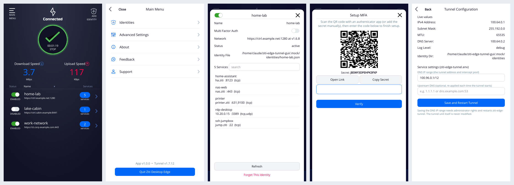

# Ziti Desktop Edge for Linux (`ziti-edge-tunnel-gui`)



A desktop GUI for the OpenZiti **`ziti-edge-tunnel`** Linux service, with the same interface as
Ziti Desktop Edge for Windows and Android: the big power button, live upload and download speeds,
the identity list with toggles, a white slide-in main menu, identity details, and MFA screens. It
runs in the background from the system tray.

The GUI is **separate from the tunneler**. It does not ship, rebuild or replace
`ziti-edge-tunnel` or its `ziti-edge-tunnel.service` unit. It only:

* controls the existing unit through systemd (**connect = start, disconnect = stop, restart**,
  plus start at boot = enable/disable), and
* talks to the running tunneler over its own IPC sockets (`/tmp/.ziti/ziti-edge-tunnel.sock` and
  `ziti-edge-tunnel-event.sock`), the same protocol the Windows client uses.

So you install the tunneler from OpenZiti as usual
(<https://netfoundry.io/docs/openziti/downloads/?os=Linux>), install this package on top, and
update either one on its own.

## Features

| Area | What it does | How |
|---|---|---|
| Connect / Disconnect / Restart | Power button, tray menu | `systemctl start/stop/restart ziti-edge-tunnel.service` |
| Start tunnel at boot | Advanced Settings toggle | `systemctl enable/disable` |
| Identities | List, enable/disable, details, services with search, forget | IPC `Status`, `IdentityOnOff`, `RemoveIdentity`, events |
| Add identity | **With JWT** (file picker or drag and drop a `.jwt`), **With URL** (external IdP) | IPC `AddIdentity` |
| External sign-in | "Authenticate With Provider" opens your browser | IPC `ExternalAuth` |
| MFA | Enable with QR code and secret, verify, authenticate, remove, view and regenerate recovery codes | IPC `EnableMFA`, `VerifyMFA`, `SubmitMFA`, `RemoveMFA`, `GetMFACodes`, `GenerateMFACodes` |
| Speeds and notifications | Live up/down rates, MFA timeout warnings, connect/disconnect toasts | `metrics` and `notification` events |
| Log level | Error to Trace, applied live | IPC `SetLogLevel` (the tunneler keeps it) |
| Tunnel config | Live IP, subnet, MTU and DNS; edit **DNS IP range**; optional **upstream DNS** | env file via root helper; IPC `SetUpstreamDNS` |
| Logs | Service log (journal) and app log, copy and save | `journalctl -u ziti-edge-tunnel` |
| Feedback | Saves a `.tar.gz` diagnostic bundle (status, logs, env file; no keys) | local |
| Background | Tray icon (green, white, red, MFA and timer variants), start at login, start minimized, close to tray | XDG autostart |

## Install

```sh
# Debian / Ubuntu
sudo apt install ./ziti-edge-tunnel-gui_1.0.2-1_all.deb
# Fedora / RHEL / Rocky / Alma (RHEL needs EPEL for PyQt)
sudo dnf install ./ziti-edge-tunnel-gui-1.0.2-1.noarch.rpm

# once per desktop user, then log out and back in
sudo usermod -aG ziti $USER
```

If you skip the `usermod` step, the app shows an **"Add me to the ziti group"** button that does
it for you (it asks for an administrator password).

**Requirements:** Python 3.8+, PyQt6 *or* PyQt5 (the app picks whichever is installed),
polkit and systemd. `python3-qrcode` is recommended so the MFA QR code shows; without it you get
the secret and a link instead.

### Tray icon on GNOME (Fedora, Debian, RHEL)

Stock GNOME has no system tray; Ubuntu adds one with its AppIndicator extension, which is why the
icon shows there out of the box. On other GNOME desktops the app still runs in the background
(it starts minimized at login, closing the window keeps it running, notifications still appear,
and launching it again from the app menu brings the window back), and it shows a
**"Show icon in top bar"** button that installs and/or enables
*AppIndicator and KStatusNotifierItem Support*. The icon then appears without restarting the
app, or after one log out and back in if the extension was just installed. To do it by hand:

```sh
sudo dnf install gnome-shell-extension-appindicator      # Debian: sudo apt install ...
gnome-extensions enable appindicatorsupport@rgcjonas.gmail.com   # then log out and back in
```

KDE Plasma, Xfce, Cinnamon, MATE and Budgie have a tray already.

## Updating

Ubuntu's App Center and GNOME Software can't upgrade a .deb from a local file: if the package
is already installed they only offer "Remove". The package upgrades normally with apt, so use
any of these:

* **From the app (1.0.2 and later):** Main Menu › About › **Install Update From File...**, or
  drop the new `.deb`/`.rpm` onto the window. It asks for an admin password, upgrades through
  apt/dnf, and restarts itself. The tunnel keeps running.
* **Automatic (optional):** build with `UPDATE_REPO=owner/repo packaging/build.sh` and attach
  the `.deb`, the `.rpm` and `dist/SHA256SUMS` to each GitHub release. The app then checks once a
  day (it can be turned off in App Settings) and offers "Version X is available. Click to install."
  Downloads are checked against `SHA256SUMS`.
* **Terminal:** `sudo apt install ./ziti-edge-tunnel-gui_<version>_all.deb` or
  `sudo dnf install ./ziti-edge-tunnel-gui-<version>.noarch.rpm`. No uninstall is needed.

The root helper only installs files whose package name is `ziti-edge-tunnel-gui`, and it copies
the file into a root-only folder before checking it.

## Permissions

* **IPC sockets:** the tunneler makes `/tmp/.ziti` group-`ziti` only, so desktop users must be
  in the `ziti` group.
* **Connect, disconnect, restart:** the package installs
  `/usr/share/polkit-1/rules.d/49-ziti-edge-tunnel-gui.rules`. It lets active, local members of
  `ziti` run start, stop and restart on `ziti-edge-tunnel.service` only, with no password, like the
  Windows and Android clients. Delete that file if you would rather always be prompted. On polkit
  older than 0.106 (for example Ubuntu 22.04 or Debian 11), JavaScript rules are ignored and you
  get an admin prompt instead.
* **Start at boot and settings changes** always need an administrator. Settings go through
  `pkexec` and the root helper `/usr/libexec/ziti-edge-tunnel-gui/ziti-edge-tunnel-gui-helper`. The
  helper accepts only a validated `ZITI_DNS_IP_RANGE` or `ZITI_VERBOSE`, joining the caller to
  `ziti`, installing the one fixed package `gnome-shell-extension-appindicator`, and the five
  systemctl verbs on this one unit.

## Notes on tunnel configuration

The stock unit runs
`ziti-edge-tunnel run --verbose=${ZITI_VERBOSE} --dns-ip-range=${ZITI_DNS_IP_RANGE} --identity-dir=${ZITI_IDENTITY_DIR}`
and reads `/opt/openziti/etc/ziti-edge-tunnel.env`. Because `--dns-ip-range` on the command line
overrides the IPC `UpdateTunIpv4` setting, the GUI changes the range by editing that env file
(comments are kept) and then restarts the service. The tunneler does not keep the upstream DNS
unless it is passed as a command-line flag, so the GUI stores it and sends it over IPC each time
the tunnel starts while the app is running. It never overrides the vendor unit's `ExecStart`.

If a future tunneler release moves something, override it without rebuilding the app:
`ZDE_SOCKET_DIR`, `ZDE_CMD_SOCKET`, `ZDE_EVENT_SOCKET`, `ZDE_DISCRIMINATOR` (for `-I`),
`ZDE_SERVICE_UNIT`, `ZDE_ENV_FILE`, `ZDE_IDENTITY_DIR`, `ZDE_ZITI_GROUP`.

## Building

```sh
make deb rpm     # -> dist/*.deb and dist/*.rpm (needs dpkg-deb and rpmbuild)
make test        # unit tests
make run-mock    # run the GUI against the bundled mock tunneler (no network needed)
```

`MAINTAINER="Name <email>" RELEASE=2 packaging/build.sh` sets the package metadata. Both
packages are architecture-independent (`all` / `noarch`).

### Developing without a real tunnel

`tests/mock_tunnel.py` implements the tunneler's IPC protocol (status, identities, services,
metrics, MFA with code `123456`, JWT enrollment, external auth) and a fake `systemctl`, so
`make run-mock` exercises every screen. `tests/screenshots.py` drives the whole flow headless
and checks it end to end.

## Layout

```
src/ziti_desktop_edge/   app (Qt shim, IPC, systemd, model, windows, tray, root helper)
bin/                     /usr/bin launcher
libexec/                 pkexec helper entry point
data/                    .desktop, autostart, polkit policy and rule, icons, AppStream
packaging/               install.sh (shared), deb/, rpm/, build.sh
tests/                   unit tests, mock tunneler, screenshot driver
```

## License

Apache-2.0. The artwork and fonts come from
[openziti/desktop-edge-win](https://github.com/openziti/desktop-edge-win) (Apache-2.0 and OFL);
see `NOTICE`. This is a community project and is not affiliated with NetFoundry.
